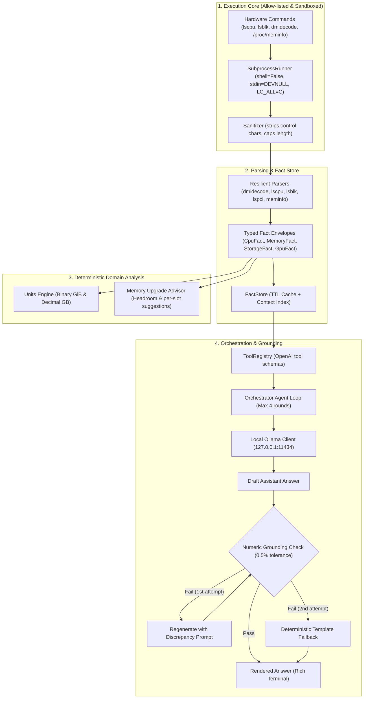

# hwq — Local Linux Hardware Q&A Assistant

A local, read-only CLI chatbot and factual analysis tool for Linux that inspects system hardware, parses raw outputs into typed Pydantic facts, calculates deterministic upgrade recommendations, and answers user questions through local LLMs with strict numeric grounding.

---

## Key Highlights

- **Safety by Construction**: All system access is read-only, executed through fixed argv lists (`shell=False`, `stdin=DEVNULL`, `LC_ALL=C`, 256 KB cap) against a pinned allowlist. No arbitrary shell execution, no `eval`, no `exec`.
- **Privilege Confinement**: Exactly one privileged command is allowed: `sudo -n dmidecode -t memory` with pinned arguments. Never requests serial numbers, UUIDs, or asset tags.
- **Code Computes, LLM Phrases**: Unit conversion (dual GiB/GB), arithmetic, and memory upgrade limits are computed deterministically in Python. Answers must pass a 0.5% tolerance numeric grounding validator before display.
- **Prompt Injection Defense**: Untrusted hardware strings (model names, device labels) are sanitized, length-capped, and fenced in `<hardware_fact ... untrusted_data="true">` XML blocks.
- **100% Offline & Swappable Backends**: Live `LinuxBackend`, offline `ReplayBackend` using recorded fixtures, and redaction-safe `RecordingBackend`. Runs and tests cleanly on Windows without WSL.
- **Live USB Snapshot Tool**: `hwq.snapshot` is standard-library-only with zero runtime dependencies, designed to record hardware fixtures directly from a minimal live USB environment.

---

## Architecture Overview



---

## Installation

### Prerequisites
- Python 3.11+
- Linux (for live system inspection) or Windows/macOS (for development & fixture replay)
- Optional: [Ollama](https://ollama.com/) running locally (`ollama serve` with `llama3.2` or `mistral`) for live LLM mode.

### Setup (Fresh Clone)
```bash
# 1. Clone repository
git clone https://github.com/GarvitSid/hwq.git
cd hwq

# 2. Create virtual environment
python -m venv .venv

# 3. Activate environment
# Linux/macOS:
source .venv/bin/activate
# Windows PowerShell:
.\.venv\Scripts\Activate.ps1

# 4. Install package and development tools
python -m pip install --upgrade pip
python -m pip install -e ".[dev]"
```

---

## Quickstart & Usage

### 1. Inspect Hardware Facts (No LLM Required)
Inspect your system hardware immediately via typed, deterministic tables:
```bash
# Display all hardware categories
hwq facts all

# Display specific categories
hwq facts cpu
hwq facts memory
hwq facts storage
hwq facts gpu
hwq facts system

# Replay on an offline synthetic fixture (works on Windows without WSL!)
hwq facts all --fixture synthetic-8gb-1of2

# Export raw JSON facts
hwq facts all --json
```

### 2. Conversational Hardware Q&A
Ask natural-language questions about your system:
```bash
# Single question with demo/scripted LLM
hwq ask "Can I upgrade my RAM?" --demo

# Inspect which tools run during turn resolution
hwq ask "Is my SSD NVMe?" --demo --show-tools

# Single question with live local Ollama
hwq ask "What CPU do I have?" --llm ollama

# Interactive REPL session
hwq --demo
```

### 3. Run System Diagnostics
Verify backend tools, sudoers rule status, and Ollama connectivity:
```bash
# Check system dependencies and configurations
hwq doctor

# Print safe, minimal sudoers configuration for dmidecode
hwq doctor --print-sudoers
```

### 4. Golden Acceptance Evaluation Suite
Run the 10 acceptance evaluation scenarios (AT-1 through AT-10):
```bash
# Run evaluation suite in terminal
hwq eval

# Export evaluation metrics as JSON
hwq eval --json
```

### 5. Record a Live USB Snapshot
From a minimal live USB environment without installing dependencies:
```bash
# Standalone execution (stdlib only, no pip dependencies needed!)
python -m hwq.snapshot --out live-snapshot-dir

# Or via installed CLI
hwq snapshot --out live-snapshot-dir
```

---

## Strict Safety Model

`hwq` is built under a strict defense-in-depth security model:

| Safety Layer | Guarantee |
| :--- | :--- |
| **No Arbitrary Execution** | The LLM **never** emits shell strings. It can only pick allow-listed tool names and validated typed arguments. All tools use `shell=False`, `stdin=DEVNULL`, `LC_ALL=C`, and strict timeout and output caps (256 KB). |
| **Privilege Containment** | Exactly **one** command may run with elevated privileges: `dmidecode -t memory` via `sudo -n`. It is strictly pinned to that exact argv sequence. Serial numbers, UUIDs, and asset tags are never queried or stored. |
| **Numeric Grounding** | LLMs cannot invent numbers. Every numeric claim (GB, GiB, MHz, MT/s, core count) is cross-checked against parsed fact envelopes within a 0.5% tolerance. Discrete counts must match exactly. Ungrounded drafts trigger regeneration or fall back to deterministic templates. |
| **Prompt Injection Defense** | All hardware strings (e.g. device model names from firmware) are treated as untrusted data: control characters and null bytes are stripped, length is capped at 120 characters, and outputs are fenced inside XML `<hardware_fact ... untrusted_data="true">` blocks with system instructions to treat them as literal data labels. |
| **Air-Gapped & Zero Telemetry** | Default network access is restricted to the local Ollama daemon at `127.0.0.1:11434`. Zero telemetry, zero analytics, zero external network requests. |

---

## Configuration

`hwq` can be configured via environment variables or a `.env` file:

| Variable | Default | Description |
| :--- | :--- | :--- |
| `HWQ_BACKEND` | `auto` | Backend choice: `auto` (Linux on Linux, replay on non-Linux), `linux`, or `replay`. |
| `HWQ_FIXTURE` | `synthetic-8gb-1of2` | Fixture name or path when using the `replay` backend. |
| `HWQ_LLM` | `ollama` | LLM client choice: `ollama` or `scripted`. |
| `HWQ_OLLAMA_URL` | `http://127.0.0.1:11434` | Endpoint for the local Ollama daemon. |
| `HWQ_OLLAMA_MODEL` | `llama3.2` | Model tag for conversational synthesis. |
| `HWQ_OLLAMA_TIMEOUT` | `30.0` | Timeout in seconds for LLM generation. |
| `HWQ_DEMO` | `false` | Enable deterministic demo mode (scripted client). |

---

## Development & Testing

```bash
# Run complete test suite (unit, integration, golden fixtures, Hypothesis)
python -m pytest -q -x

# Run code style and linter check
python -m ruff check .

# Run strict static type checking
python -m mypy src

# Run golden eval suite
python -m hwq.cli eval
```

---

## License

Apache 2.0. See [LICENSE](LICENSE) for details.
